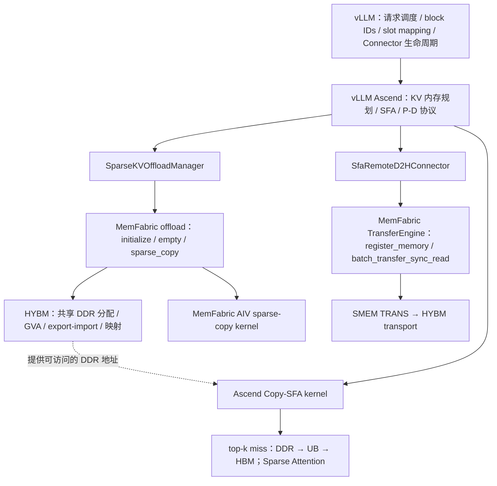
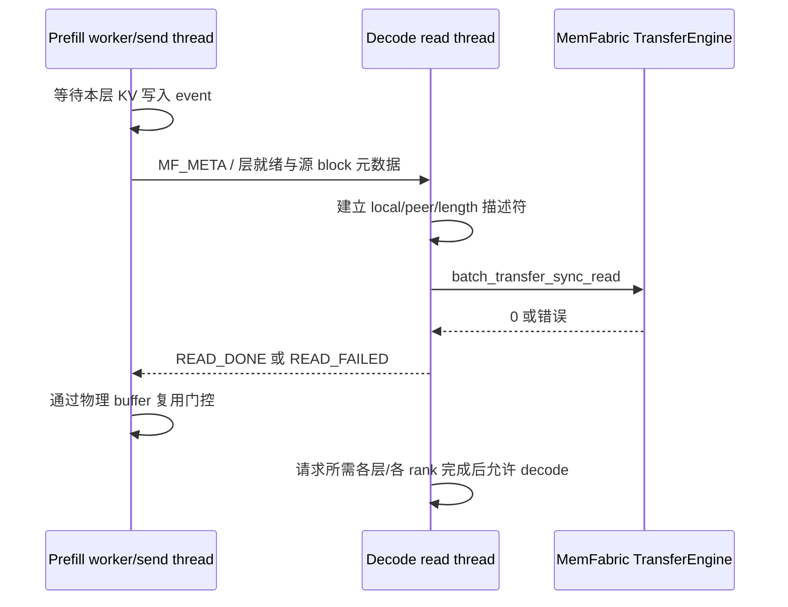

# vLLM Ascend 与 MemFabric：DSA Decode Offload 接口分析

本报告基于 2026-11-04 下载的源码快照，重点覆盖 DSA/MLA decode offload。源码版本、下载来源与发布包校验值见 [版本清单](../manifest.json)。这是静态源码分析，未在 NPU 上编译、运行或测量性能；三个默认分支的 HEAD 不应被视为已经验证兼容的部署组合。

最重要的结论：vLLM Ascend 与 MemFabric 有两组直接接口。`offload` 建立设备可访问的共享 DDR 池，执行本地稀疏拷贝；`TransferEngine` 注册 Prefill 内存并让 Decode 远端拉取。默认 top-k miss 的 DDR→HBM 搬运与 attention 融合在 vLLM Ascend 自己的 Copy-SFA 算子中，不能把全部读写都归到 `TransferEngine` 或 `offload.sparse_copy()`。

**源码与版本边界。**

| 仓库 | 本次快照 | 本地目录 | 用途 |
|---|---|---|---|
| vLLM | `5225a1f17f9cf721efd5ad793e6b63798ca30306` | `repos/vllm` | 调度、KV block/slot、Connector 框架与 HiSparse 对照 |
| vLLM Ascend | `bee583c95f7e3222fd79a4deba206a6b2d9694b3` | `repos/vllm-ascend` | 本报告的调用方 |
| MemFabric，官方 GitCode | `f6bc00e251524a21fa2e2a9f8ef2d028df9991b6` | `repos/memfabric_hybrid` | 本报告的被调用方及 C++/AscendC 实现 |
| MemFabric，GitHub 镜像 | `004d9317289fe99bd6bf13def0500b3fa3795ccc` | `repos/memfabric_hybrid-github-mirror` | 保留供版本差异核对，不用于解释当前 offload 实现 |

上述目录均为浅克隆：包含对应提交的完整受版本控制源码，不含完整 Git 历史，未递归下载子模块。GitHub 镜像 HEAD 的提交日期为 2026-06-03，找不到当前 `offload` 实现。官方 GitCode HEAD 有完整 `src/acc_offload`。当前 Ascend 的依赖文件固定 `memfabric-hybrid==1.3.0`，因此另下载了该版本的 CPython 3.11 / Linux x86_64 wheel，校验 PyPI SHA256 后提取其中的 Python 和内核源码，未安装或执行。官方 HEAD 比发布包新：下文 C++ 行为指向 HEAD，涉及发布包的结论单独注明。

**整体边界。**



vLLM 不决定 MemFabric 的物理分配或传输协议。Ascend 将主 KV 标记为 host 存储，规划 DDR 与 NPU 容量，构造地址描述符、top-k 与热点状态；MemFabric 对外处理内存、地址和拷贝，不理解 token 的模型语义。vLLM 上游 HiSparse 是另一条实现，不能将其 CUDA kernel 当成 Ascend SparseKVOffloadManager 的下层。参见 [model_runner.py:488](../repos/vllm-ascend/vllm_ascend/worker/v2/model_runner.py#L488)、[sparse_kv_offload_manager.py:239](../repos/vllm-ascend/vllm_ascend/distributed/kv_transfer/sparse_kv_offload/sparse_kv_offload_manager.py#L239)、[hisparse.md:1](../repos/vllm/docs/design/hisparse.md#L1)。

**关键接口索引。**

| 接口 | Ascend 调用位置 | MemFabric 定义/实现 | 用途与完成语义 |
|---|---|---|---|
| `offload.OffloadConfig` / `Scene.SHARED` | [sparse_kv_offload_manager.py:543](../repos/vllm-ascend/vllm_ascend/distributed/kv_transfer/sparse_kv_offload/sparse_kv_offload_manager.py#L543) | [pymf_acc_offload.cpp:27](../repos/memfabric_hybrid/src/acc_offload/csrc/python_wrapper/pymf_acc_offload.cpp#L27) | 配置当前 TP 组的共享 DDR 池 |
| `offload.initialize(config)` | [sparse_kv_offload_manager.py:543](../repos/vllm-ascend/vllm_ascend/distributed/kv_transfer/sparse_kv_offload/sparse_kv_offload_manager.py#L543) | [acc_offload.cpp:18](../repos/memfabric_hybrid/src/acc_offload/csrc/acc_offload.cpp#L18) → [acc_offload_shared_dram_entry.cpp:469](../repos/memfabric_hybrid/src/acc_offload/csrc/acc_offload_shared_dram_entry.cpp#L469) | 建立 pool、地址映射和组内交换；返回 0 表示初始化成功 |
| `offload.empty(sizes, dtype, pin_memory)` | [sparse_kv_offload_manager.py:180](../repos/vllm-ascend/vllm_ascend/distributed/kv_transfer/sparse_kv_offload/sparse_kv_offload_manager.py#L180) | [mf_acc_offload.py:22](../repos/memfabric_hybrid/src/smem/python/memfabric_hybrid/memfabric_hybrid/mf_acc_offload.py#L22) | 从 MemFabric 池分配，并包装成 CPU tensor view |
| `offload.sparse_copy(src, dst, lengths, count, device)` | [sparse_kv_offload_manager.py:1164](../repos/vllm-ascend/vllm_ascend/distributed/kv_transfer/sparse_kv_offload/sparse_kv_offload_manager.py#L1164)、[sparse_kv_offload_manager.py:1114](../repos/vllm-ascend/vllm_ascend/distributed/kv_transfer/sparse_kv_offload/sparse_kv_offload_manager.py#L1114) | [mf_acc_offload.py:22](../repos/memfabric_hybrid/src/smem/python/memfabric_hybrid/memfabric_hybrid/mf_acc_offload.py#L22) → [acc_offload.cpp:55](../repos/memfabric_hybrid/src/acc_offload/csrc/acc_offload.cpp#L55) → [acc_offload_operators_launch.cpp:19](../repos/memfabric_hybrid/src/acc_offload/csrc/launch/acc_offload_operators_launch.cpp#L19) | 当前 NPU stream 上异步提交 AIV copy；返回成功不等于设备执行完成 |
| `TransferEngine.initialize(...)` | [memfabric_transfer_engine.py:161](../repos/vllm-ascend/vllm_ascend/distributed/kv_transfer/utils/memfabric_transfer_engine.py#L161) | [pytransfer.cpp:45](../repos/memfabric_hybrid/src/smem/csrc/python_wrapper/mk_transfer_adapter/csrc/pytransfer.cpp#L45) | 建立 P/D transfer engine，选择数据协议 |
| `TransferEngine.get_rpc_port()` | [memfabric_transfer_engine.py:161](../repos/vllm-ascend/vllm_ascend/distributed/kv_transfer/utils/memfabric_transfer_engine.py#L161) | [pytransfer.cpp:110](../repos/memfabric_hybrid/src/smem/csrc/python_wrapper/mk_transfer_adapter/csrc/pytransfer.cpp#L110) | 获取监听端口，与 hostname 组成 session ID |
| `TransferEngine.register_memory(ptr, bytes)` | [memfabric_transfer_engine.py:206](../repos/vllm-ascend/vllm_ascend/distributed/kv_transfer/utils/memfabric_transfer_engine.py#L206)、[worker.py:856](../repos/vllm-ascend/vllm_ascend/distributed/kv_transfer/kv_p2p/sfa_pd_rd2h/worker.py#L856) | [pytransfer.cpp:326](../repos/memfabric_hybrid/src/smem/csrc/python_wrapper/mk_transfer_adapter/csrc/pytransfer.cpp#L326) | 注册 Prefill 可供远端访问的内存范围；不执行 KV 传输 |
| `TransferEngine.batch_transfer_sync_read(session, local, peer, sizes)` | [read_thread.py:1125](../repos/vllm-ascend/vllm_ascend/distributed/kv_transfer/kv_p2p/sfa_pd_rd2h/read_thread.py#L1125) | [pytransfer.cpp:228](../repos/memfabric_hybrid/src/smem/csrc/python_wrapper/mk_transfer_adapter/csrc/pytransfer.cpp#L228) → [smem_trans.cpp:241](../repos/memfabric_hybrid/src/smem/csrc/smem_trans/smem_trans.cpp#L241) → [smem_trans_connection.cpp:765](../repos/memfabric_hybrid/src/smem/csrc/smem_trans/smem_trans_connection.cpp#L765) | Decode 拉取 Prefill 地址范围；同步 read 返回成功后 connector 才确认完成 |
| `set_log_level(2)` / `set_conf_store_tls(False, "")` | [memfabric_transfer_engine.py:161](../repos/vllm-ascend/vllm_ascend/distributed/kv_transfer/utils/memfabric_transfer_engine.py#L161) | MemFabric Python 导出 | 引擎初始化的日志/配置存储设置，不是 KV 数据搬运接口 |

直接 import 与调用主要集中在两个文件：[sparse_kv_offload_manager.py:476](../repos/vllm-ascend/vllm_ascend/distributed/kv_transfer/sparse_kv_offload/sparse_kv_offload_manager.py#L476) 与 [memfabric_transfer_engine.py:27](../repos/vllm-ascend/vllm_ascend/distributed/kv_transfer/utils/memfabric_transfer_engine.py#L27)。`offload.free/uninitialize/get_dva` 等虽由 MemFabric 暴露，但本次检查的 SparseKVOffloadManager 未直接调用；不能将“库提供接口”写成“Ascend 已使用接口”。

**共享 DDR 池如何创建。**

Ascend 传入的关键字段如下；`pool_bytes` 是规划值，不应简单等同于配置上限：

```python
config.device_id = torch_npu.npu.current_device()
config.reserve_size = pool_bytes
config.alloc_size = pool_bytes if tp_rank == 0 else 0
config.world_size = tp_size
config.rank_id = tp_rank
config.scene = offload.Scene.SHARED
config.store_url = f"tcp://127.0.0.1:{base_port + dp_index}"
assert offload.initialize(config) == 0
tp_group.barrier()
```

| 字段 | 内存语义 |
|---|---|
| `reserve_size` | 每 rank 的统一虚拟 slot 跨度；底层向上按 GiB 对齐。SHARED 组内必须一致 |
| `alloc_size` | 当前 rank 实际贡献的物理 DDR；可小于 reserve，Ascend 只有 TP0 非零 |
| `world_size/rank_id` | 此处对应当前 TP 组，不是整个服务的 DP×TP 总规模 |
| `store_url` | offload 组内协商地址，与 P/D TransferEngine 的 session/RPC 地址是两套概念 |
| `scene` | Ascend 当前选择 SHARED；不可用 LOCAL/URMA 特殊模式的地址假设替换它 |

调用链：

```text
offload.initialize
  → pybind: offload_init
  → AccOffloadEntryManager::Initialize
  → CreateEntry(SHARED)
  → AccOffloadSharedDramEntry::Initialize
  → InitSharedPool
      → CreateGroupStore
      → CreateEntityAndPool
          → hybm_create_entity
          → ReserveSharedPool：组内协商相同 GVA
          → hybm_alloc_local_memory + hybm_export
          → GroupAllGather + hybm_import
      → hybm_mmap
      → hybm_get_memory_ptr(HOST)
      → ExchangeAndValidatePoolFingerprint
```

当前官方 HEAD 的 `ReserveSharedPool()` 收集各 rank 可用 VA 候选，选择共同地址并 reserve；建立 pool 时设置 `HYBM_DOP_TYPE_MTE`、`HYBM_SCENE_OFFLOAD` 和 `HYBM_FLAG_DRAM_MAP_HOST_VA`。HYBM VMM 层进一步使用驱动 `HalMemCreate/Export/Import/Map` 等能力建立物理 DRAM 与主机/设备虚拟地址之间的映射。参见 [acc_offload_shared_dram_entry.cpp:298](../repos/memfabric_hybrid/src/acc_offload/csrc/acc_offload_shared_dram_entry.cpp#L298)、[acc_offload_shared_dram_entry.cpp:327](../repos/memfabric_hybrid/src/acc_offload/csrc/acc_offload_shared_dram_entry.cpp#L327)、[acc_offload_shared_dram_entry.cpp:398](../repos/memfabric_hybrid/src/acc_offload/csrc/acc_offload_shared_dram_entry.cpp#L398)、[hybm_vmm_based_segment.cpp:338](../repos/memfabric_hybrid/src/hybm/csrc/mm/hybm_vmm_based_segment.cpp#L338)。

这解释了为何 TP0 的 DDR 地址可以广播后由其他 TP 进程使用：不是仅靠广播一个普通 malloc 指针，而是 MemFabric 已经为这组进程建立了共享地址映射。Ascend 随后广播每层 base、shape、block stride，非 TP0 用 `sparse_kv_restore_bfloat16_tensor(ptr, shape)` 恢复 view，并校验地址、shape、dtype。参见 [sparse_kv_offload_manager.py:741](../repos/vllm-ascend/vllm_ascend/distributed/kv_transfer/sparse_kv_offload/sparse_kv_offload_manager.py#L741)、[sparse_kv_offload_manager.py:622](../repos/vllm-ascend/vllm_ascend/distributed/kv_transfer/sparse_kv_offload/sparse_kv_offload_manager.py#L622)。

物理主 KV 总量大致按 DP 份数增长；不能把 TP 每个 rank 的 `reserve_size` 都当作实际物理分配。底层 GiB 向上对齐还会使实际预留/分配与逻辑可用字节数存在差异。

**`empty()` 的实质与生命周期。**

Python `empty()` 先算字节数，调用 `offload.malloc()`，然后用 `ctypes.from_address(ptr)` 与 `torch.frombuffer()` 包装同一块存储。它并不复制 KV，也不调用 PyTorch 的普通 pinned allocator。

特别需要修正一个容易凭名称产生的理解：在本次 HEAD 及已提取的 1.3.0 Python wrapper 中，`pin_memory` 参数没有参与分支，也没有调用 `.pin_memory()`；设备可访问性来自之前 MemFabric/HYBM 的内存池初始化和映射。不能仅看到 `pin_memory=True` 就认为底层等价于 `torch.empty(..., pin_memory=True)`。参见 [mf_acc_offload.py:22](../repos/memfabric_hybrid/src/smem/python/memfabric_hybrid/memfabric_hybrid/mf_acc_offload.py#L22)、[mf_acc_offload.py:22](../releases/memfabric-1.3.0-python/memfabric_hybrid/mf_acc_offload.py#L22)。

Ascend 的 `empty_aligned_int8_cpu_tensors()` 从 pool 取得一块 raw buffer，按 K/CKV 与 V/KPE 所需大小切出对齐 view，随后 reshape 为 BF16 分页布局。`empty()` 返回的 tensor 是外部存储 view，不能把删除 view 直接理解成调用了 `offload.free()`。MemFabric 暴露 free/uninitialize，并在 C++ manager 析构时清理；Ascend 这条 manager 路径没有显式逐层 free/uninitialize。热重启或同进程重建 pool 需要额外核对生命周期，不能从当前代码推断已经支持。参见 [sparse_kv_offload_manager.py:180](../repos/vllm-ascend/vllm_ascend/distributed/kv_transfer/sparse_kv_offload/sparse_kv_offload_manager.py#L180)、[acc_offload_entry_manager.cpp:28](../repos/memfabric_hybrid/src/acc_offload/csrc/acc_offload_entry_manager.cpp#L28)。

**新 token 写 DDR：`sparse_copy()` 的准确 ABI。**

```text
SFA.exec_kv
  → _compute_kv_only：生成 CKV 与 KPE
  → 当前 KV 写 HBM tail/hot slot（默认 Copy-SFA）
  → offload_new_kv
  → _offload_new_kv_on_current_stream
  → offload.sparse_copy
```

只有 TP0 写回复制的当前 token KV。对于 slot `s`，目的地址分别为：

```text
CKV_dst = layer_ckv_base + s × ckv_row_bytes
KPE_dst = layer_kpe_base + s × kpe_row_bytes
```

`s` 来自 vLLM/Ascend 准备的 `slot_mapping`，不是请求内 token 序号本身。当前无效或 padding slot 通过长度置零跳过。参见 [sfa_kv_offload.py:854](../repos/vllm-ascend/vllm_ascend/attention/sfa_kv_offload.py#L854)、[sparse_kv_offload_manager.py:1164](../repos/vllm-ascend/vllm_ascend/distributed/kv_transfer/sparse_kv_offload/sparse_kv_offload_manager.py#L1164)。

| Python 参数 | Ascend tensor | Native 解释 | 注意点 |
|---|---|---|---|
| `srcPtrs` | NPU int64 数组 | `uint64_t*`，每项是源数据地址 | 数组本身在设备上 |
| `dstPtrs` | NPU int64 数组 | `uint64_t*`，每项是目的数据地址 | DDR 地址必须设备可访问 |
| `lenPtrs` | NPU int32 数组 | `uint32_t*`，每项是 byte count | 不是 token 数或 BF16 元素数 |
| `sizePtr` | NPU int32 单元素 tensor | `uint32_t*`，设备侧描述符数量 | 不是 Python 整数 |
| `deviceId` | `torch.device` | Python wrapper 取 `.index` | native 最终使用 device index |

对 T 个当前 token，Ascend 准备 `2T` 项：前 T 项 CKV，后 T 项 KPE。Python wrapper 只取上述 tensor 的 `data_ptr()` 传给 C++；四个 tensor 的内容仍由设备读取。内核按 `uint8_t` 实例化，因此 lengths 的单位是字节。参见 [mf_acc_offload.py:22](../repos/memfabric_hybrid/src/smem/python/memfabric_hybrid/memfabric_hybrid/mf_acc_offload.py#L22)、[acc_offload.cpp:55](../repos/memfabric_hybrid/src/acc_offload/csrc/acc_offload.cpp#L55)、[acc_offload_sparse_copy.cpp:15](../repos/memfabric_hybrid/src/acc_offload/csrc/operators/acc_offload_sparse_copy.cpp#L15)。

完整 native 调用链：

```text
offload.sparse_copy(Tensor, Tensor, Tensor, Tensor, device)
  → mf_acc_offload.py：取各描述符 tensor 的 data_ptr
  → _pymf_acc_offload.offload.sparse_copy
  → offload_sparse_copy(uint64_t, uint64_t, uint64_t, uint64_t, uint16_t)
  → AccOffloadEntryManager::SparseCopy
  → AccOffloadSharedDramEntry::SparseCopy
  → AccOffloadLaunchApi::AccOffloadSparseCopy
  → getCurrentNPUStream + OpCommand::RunOpApiV2
  → OffloadSparseCopyOps<<<..., current_stream>>>
  → GM(src) → UB → GM(dst)
```

这不是逐条 Python memcpy，也不是 P/D 的 RDMA read；是 AIV-only 内核通过 `DataCopyPad` 完成的地址列表拷贝。源和目的描述符决定 D2H/H2D 方向，API 没有额外 direction 参数。当前内核包含按总字节分工和 K/V 成对的两种实现，后者用双 buffer；Ascend 前半 CKV、后半 KPE 的排布与成对路径相匹配。参见 [acc_offload_operators_launch.cpp:19](../repos/memfabric_hybrid/src/acc_offload/csrc/launch/acc_offload_operators_launch.cpp#L19)、[acc_offload_sparse_copy.h:243](../repos/memfabric_hybrid/src/acc_offload/csrc/operators/acc_offload_sparse_copy.h#L243)。

`sparse_copy()` 返回 0 仅代表这层提交成功，内核在当前 NPU stream 上异步执行。默认路径依赖同 stream 顺序；`use_fused_overlap` 的 capture/decode 分支用 `current_kv_save_stream` 写回，先等待当前 KV ready event，随后在消费链的相应位置执行 `wait_for_current_kv_writeback()`。MemFabric 本身不替 Ascend 推断跨 stream 的模型数据依赖。参见 [sparse_kv_offload_manager.py:1120](../repos/vllm-ascend/vllm_ascend/distributed/kv_transfer/sparse_kv_offload/sparse_kv_offload_manager.py#L1120)、[sparse_kv_offload_manager.py:1477](../repos/vllm-ascend/vllm_ascend/distributed/kv_transfer/sparse_kv_offload/sparse_kv_offload_manager.py#L1477)。

**DDR 读回：默认 top-k 路径与 tail 维护要分开。**

默认 `use_fused_overlap=False` 时启用 fused LIM + Copy-SFA：

```text
HBM Indexer KV
  → npu_fused_lightning_indexer_manage（或 INT8 变体）
  → topk_src / topk_dst / miss lists / miss counts
  → npu_fused_scatter_copy_sparse_flash_attention
       registered DDR views + DDR block table
       HBM hot buffers + HBM block table
  → DDR miss → UB → HBM，融合 attention
```

这里 `dram_kv_cache` 和 `dram_k_rope` 由 MemFabric pool 支撑，但真正读取它们的是 **Ascend 仓库内的 Copy-SFA kernel**。首次填充通过核内同步再进入 attention；稳态路径搬 miss 并与 attention 流水重叠。查找、替换、top-k 映射属于 Ascend 的管理和算子层；MemFabric 没有替模型计算 top-k。参见 [sfa_kv_offload.py:676](../repos/vllm-ascend/vllm_ascend/attention/sfa_kv_offload.py#L676)、[sfa_kv_offload.py:775](../repos/vllm-ascend/vllm_ascend/attention/sfa_kv_offload.py#L775)、[first_fill_scatter_copy_kernel.h:22](../repos/vllm-ascend/csrc/attention/fused_scatter_copy_sparse_flash_attention/op_kernel/first_fill_scatter_copy_kernel.h#L22)。

`SparseKVOffloadManager.copy_sfa_kv()` 也调用 `offload.sparse_copy()`，用于 dense fill、tail 恢复等维护路径。因此既不能说“所有 H2D 都走 Copy-SFA”，也不能说“所有 top-k miss 都走 MemFabric sparse_copy”。当前 token 通常先直接写入 HBM tail，避免为了本步使用而先 D2H 再 H2D。参见 [sparse_kv_offload_manager.py:1114](../repos/vllm-ascend/vllm_ascend/distributed/kv_transfer/sparse_kv_offload/sparse_kv_offload_manager.py#L1114)、[sfa_kv_offload.py:854](../repos/vllm-ascend/vllm_ascend/attention/sfa_kv_offload.py#L854)。

DDR 物理位置与 HBM 热点位置独立：

```text
src_block = dram_block_table[request, logical_token // block_size]
src_row   = src_block * block_size + logical_token % block_size
src_addr  = dram_base + src_row * row_bytes

dst_block = hbm_block_table[request, hot_slot // block_size]
dst_row   = dst_block * block_size + hot_slot % block_size
dst_addr  = hbm_base + dst_row * row_bytes
```

热点 eviction 通常只覆盖 HBM 副本，不需要把被淘汰的历史 KV 再写回 DDR；DDR 中保留原始历史。slot 重用、请求结束、MTP 的可见范围仍需上层 metadata 正确维护。默认 Copy-SFA 路径的块大小、top-k、head dimensions 有固定约束，应查 [README.md:1](../repos/vllm-ascend/csrc/attention/fused_scatter_copy_sparse_flash_attention/README.md#L1)，不能将示例参数推广到所有 attention backend。

**P/D 远端拉取：TransferEngine 的接口契约。**

Ascend 初始化：

```python
raw_engine.initialize(
    f"tcp://{hostname}", hostname, role, device_id,
    store_server_role="Prefill",
    data_op_type=TransDataOpType.SDMA,  # 或 DEVICE_RDMA / DEVICE_URMA
)
session_id = f"{hostname}:{raw_engine.get_rpc_port()}"
```

这里的 `role` 是 `Prefill` 或 `Decode`，由 wrapper 映射到 SMEM sender/receiver 配置。`GlobalMemfabricTE` 在进程内保留单例，role/device/protocol 绑定后不允许改成另一套配置。`memfabric_transfer_protocol` 控制 TransferEngine 数据通道，不改变 `offload.sparse_copy()` 是 AIV kernel 的事实。参见 [memfabric_transfer_engine.py:27](../repos/vllm-ascend/vllm_ascend/distributed/kv_transfer/utils/memfabric_transfer_engine.py#L27)。

值得注意的版本差异：本次官方 HEAD 的 `TransferAdapterPy::Initialize()` 保留 `storeUrl/storeServerRole` 兼容参数，但实现写明这些参数不再决定 store 行为，内部使用 TCP 并在首次拷贝时按对端 ID 惰性建链。不能只看 Ascend 传入 `store_server_role="Prefill"` 就断言最新 MemFabric 内部仍完全遵循旧版架构。此点是 HEAD 源码结论，未反推发布 wheel 的 native 二进制。参见 [pytransfer.cpp:45](../repos/memfabric_hybrid/src/smem/csrc/python_wrapper/mk_transfer_adapter/csrc/pytransfer.cpp#L45)。

Prefill 对实际 HBM 存储区域执行 `register_memory(ptr, size)`。若逻辑层复用同一物理 buffer，需要以真实物理存储范围注册。native 链路为 `TransferAdapterPy::RegisterMemory → smem_trans_register_mem → RegisterLocalMemory → hybm_register_local_memory + hybm_export`，供后续连接交换和地址转换。参见 [worker.py:856](../repos/vllm-ascend/vllm_ascend/distributed/kv_transfer/kv_p2p/sfa_pd_rd2h/worker.py#L856)、[pytransfer.cpp:326](../repos/memfabric_hybrid/src/smem/csrc/python_wrapper/mk_transfer_adapter/csrc/pytransfer.cpp#L326)、[smem_trans_entry.cpp:807](../repos/memfabric_hybrid/src/smem/csrc/smem_trans/smem_trans_entry.cpp#L807)。

Decode 侧先取得 manager 的 shared DDR bases 与每层 block bytes，同时保留 rank-local 的 Indexer HBM 地址。当前 `_register_memfabric_pull()` 创建 engine 时明确走“no registration”分支；不能声称它在 Python 层把所有 Decode 目的 buffer 再逐一 `register_memory()`。参见 [worker.py:456](../repos/vllm-ascend/vllm_ascend/distributed/kv_transfer/kv_p2p/sfa_pd_rd2h/worker.py#L456)。

核心 read 调用：

```python
ret = engine.batch_transfer_sync_read(
    p_session,
    all_local_ptrs,  # Decode 目的地址：主 KV 为 DDR，Indexer 为 HBM
    all_peer_ptrs,   # Prefill 源地址
    all_lengths,    # 字节数
)
```

| 参数 | 契约 |
|---|---|
| `session_id` | Prefill engine 的 `IP:RPC port`，不是模型请求 ID |
| `local_buffers` | Decode 目的地址列表，Python `list[int]` |
| `peer_buffers` | Prefill 已注册区域中的源地址列表 |
| `length_list` | 与两地址列表等长，每项字节数；批量 read 不沿用 sparse_copy 的零长度跳过约定 |
| 返回值 | 底层 0 成功；Ascend adapter 把非零规范为 -1，调用方抛出异常 |

与 `sparse_copy()` 的“设备 tensor 描述符”不同，TransferEngine 用 host Python lists，经 pybind 转成 C++ vectors。底层按 `remote session + remote VA` 查询已交换的区域并转换为可访问地址，再选择传输后端。参见 [read_thread.py:1125](../repos/vllm-ascend/vllm_ascend/distributed/kv_transfer/kv_p2p/sfa_pd_rd2h/read_thread.py#L1125)、[pytransfer.cpp:228](../repos/memfabric_hybrid/src/smem/csrc/python_wrapper/mk_transfer_adapter/csrc/pytransfer.cpp#L228)、[smem_trans_connection.cpp:765](../repos/memfabric_hybrid/src/smem/csrc/smem_trans/smem_trans_connection.cpp#L765)。

```text
MembPullReadThread
  → MemfabricBackend.batch_transfer_sync_read
  → TransferAdapterPy::BatchTransferSyncRead
  → smem_trans_batch_read
  → SmemTransEntry::BatchSyncTransfer
  → GetOrCreateConnection
  → SmemTransConnection::BatchSyncTransfer
      → TransformAddr(remote slices)
      → hybm_data_batch_copy(mapped_remote_sources, local_destinations)
```

此 read 调用传入 null stream，按同步传输路径返回；pybind 释放 GIL，但“释放 GIL”不等于“接口变成异步完成”。Ascend 在后台 read thread 中执行它，以避免将整个远端 read 放进模型计算线程。异步 submit API 由库提供，但当前 SFA RD2H 调用点没有使用。参见 [smem_trans.cpp:241](../repos/memfabric_hybrid/src/smem/csrc/smem_trans/smem_trans.cpp#L241)、[smem_trans_connection.cpp:765](../repos/memfabric_hybrid/src/smem/csrc/smem_trans/smem_trans_connection.cpp#L765)。

**完成通知和 buffer 复用由谁保证。**



ZMQ 消息、层/请求状态、`READ_DONE/READ_FAILED` 属于 Ascend connector，不是 MemFabric 的模型级协议。MemFabric 的传输返回，只能说明这次传输；是否全部层就绪、是否可以开始 decode、某个复用 buffer 是否还有其他消费者，由 Ascend 决定。组合 Prefill layerwise offload 时，还需等待 Prefill 自己的 Memcache save 完成。参见 [send_thread.py:345](../repos/vllm-ascend/vllm_ascend/distributed/kv_transfer/kv_p2p/sfa_pd_rd2h/send_thread.py#L345)、[read_thread.py:314](../repos/vllm-ascend/vllm_ascend/distributed/kv_transfer/kv_p2p/sfa_pd_rd2h/read_thread.py#L314)、[worker.py:1146](../repos/vllm-ascend/vllm_ascend/distributed/kv_transfer/kv_p2p/sfa_pd_rd2h/worker.py#L1146)。

**地址类型和接口混淆检查。**

| 容易混淆的项 | 正确理解 |
|---|---|
| CPU tensor = 普通 CPU malloc | 此处 CPU tensor 是已映射 DDR pool 的 view |
| `pin_memory=True` = wrapper 调用 pin | 此 wrapper 未使用该参数，实际映射在 HYBM 层 |
| 广播 raw pointer 足以跨进程访问 | 先建立共享 GVA/物理映射，广播只是上层传递每层 offset/base |
| `reserve_size × TP` 是物理 DDR | reserve 是虚拟 slot stride，物理贡献由每 rank 的 alloc 决定 |
| `sparse_copy` 等价于 SDMA/RDMA read | 此调用链启动 AIV kernel；TE 协议选择是另一条链 |
| sparse copy 返回 0 即可复用源 tensor | 它异步入当前 stream，必须保持源与描述符生命周期及 stream 依赖 |
| 主 KV 和 Indexer 一起进 DDR | 当前主 KV 落 Decode DDR，Indexer/scale 落 rank-local HBM |
| MemFabric 维护 top-k/LRU | 管理逻辑在 Ascend，MemFabric 提供内存与拷贝能力 |
| 默认 miss 一律经 `offload.sparse_copy` | 默认 Copy-SFA 自己读 DDR；tail/dense fill 等才另走 sparse_copy |
| 所有 host pointer 都可当 device pointer | 当前 SHARED GVA 路径成立；LOCAL giant-page/URMA 模式可能需要 `get_dva()`，不能泛化 |

最后一项可直接由 [acc_offload_shared_dram_entry.cpp:607](../repos/memfabric_hybrid/src/acc_offload/csrc/acc_offload_shared_dram_entry.cpp#L607) 和 [acc_offload.h:117](../repos/memfabric_hybrid/src/acc_offload/include/host/acc_offload.h#L117) 核对。Ascend 当前路径使用 SHARED GVA，没有调用 `get_dva` 做地址转换。

**与 Memcache、其他 offload 的边界。**

`AscendStoreConnector → MemcacheBackend → memcache_hybrid.DistributedObjectStore` 是 KV Pool / Prefill layerwise 存取接口；其 `batch_get_into/put_from/batch_put_from_layers` 不等于本文的 `memfabric_hybrid.offload`。MemFabric 仓库也包含相关上层组件，但应区分 object-key 存储 API 与裸地址内存传输 API。参见 [memcache_backend.py:223](../repos/vllm-ascend/vllm_ascend/distributed/kv_transfer/kv_pool/ascend_store/backend/memcache_backend.py#L223)。

原生通用 CPU OffloadingConnector、抢占后保存 KV，以及上游 HiSparse 也有各自的数据与生命周期管理，不能把其中某个接口名替换进本文调用链。当前主线文件可按以下顺序阅读：[sparse_kv_offload_manager.py:476](../repos/vllm-ascend/vllm_ascend/distributed/kv_transfer/sparse_kv_offload/sparse_kv_offload_manager.py#L476) → [mf_acc_offload.py:22](../repos/memfabric_hybrid/src/smem/python/memfabric_hybrid/memfabric_hybrid/mf_acc_offload.py#L22) → [acc_offload.cpp:18](../repos/memfabric_hybrid/src/acc_offload/csrc/acc_offload.cpp#L18) → [acc_offload_shared_dram_entry.cpp:327](../repos/memfabric_hybrid/src/acc_offload/csrc/acc_offload_shared_dram_entry.cpp#L327) → [acc_offload_operators_launch.cpp:19](../repos/memfabric_hybrid/src/acc_offload/csrc/launch/acc_offload_operators_launch.cpp#L19) → [acc_offload_sparse_copy.h:243](../repos/memfabric_hybrid/src/acc_offload/csrc/operators/acc_offload_sparse_copy.h#L243)；P/D 支线阅读 [memfabric_transfer_engine.py:27](../repos/vllm-ascend/vllm_ascend/distributed/kv_transfer/utils/memfabric_transfer_engine.py#L27) → [read_thread.py:1125](../repos/vllm-ascend/vllm_ascend/distributed/kv_transfer/kv_p2p/sfa_pd_rd2h/read_thread.py#L1125) → [pytransfer.cpp:228](../repos/memfabric_hybrid/src/smem/csrc/python_wrapper/mk_transfer_adapter/csrc/pytransfer.cpp#L228) → [smem_trans_connection.cpp:765](../repos/memfabric_hybrid/src/smem/csrc/smem_trans/smem_trans_connection.cpp#L765)。

**验证范围。**

已核对三份主源码与额外 GitHub 镜像的 Git HEAD、仓库来源和本地 clean 状态；核对 Ascend 的 1.3.0 依赖与 wheel SHA256；检查本文源码链接指向的文件、行号和符号。未改动仓库代码，未安装 Linux wheel，未运行 NPU/CANN kernel 或端到端 serving。当前 HEAD 中的 GVA 协商、TransferEngine store 行为与 1.3.0 二进制之间的完整差异，仍需以发布构建 provenance 或目标环境实测确认。
