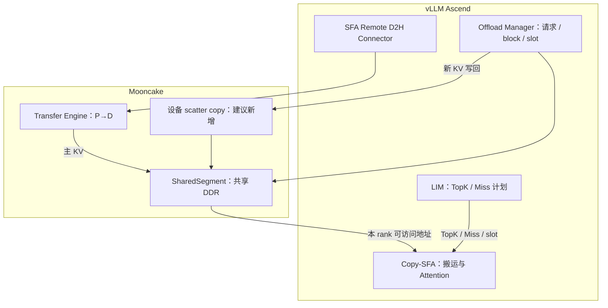

# vLLM Ascend DSA Decode Offload 迁移 Mooncake 策略

整理日期：2026-11-04（Asia/Shanghai）

本文围绕 `SparseKVOffloadManager`、`SfaRemoteD2HConnector`、Copy-SFA 三个组件，说明 Mooncake 已有能力、建议的职责边界、代码落点和分阶段实施方案。文中的“建议新增”属于架构设计，不代表 Mooncake 已提供对应 API 或社区已承诺实施。

## 1. 结论

**推荐让 Mooncake 承接共享 DDR 内存、远程传输和通用设备搬运，让 vLLM Ascend 保留请求调度、稀疏缓存状态和融合 Attention。**

Mooncake 已经实现面向 MLA decode offload 的共享 Host Segment，可以作为替换 MemFabric 共享 DDR 分配层的基础；Ascend Transfer Engine 可以作为 SFA Remote D2H 的候选传输后端。当前检查的源码和公开讨论中，未找到完整 Offload Manager、SFA Remote D2H Connector、Copy-SFA 已迁入 Mooncake 的证据。

迁移目标不应定义为“把三个组件原样搬进 Mooncake”，而应定义为：

1. 用 Mooncake SharedSegment 提供 TP 共享、NPU 可访问的 DDR。
2. 用 Mooncake Transfer Engine 承接 P→D 的主 KV / Indexer KV 传输。
3. 为通用 D2H/H2D 补充可选的 Ascend 设备搬运接口，逐步替代 MemFabric `offload.sparse_copy`。
4. 保持 LIM、Copy-SFA 与推理执行流的融合关系。

完整替换是否可行，最终取决于目标 CANN/HiXL/驱动组合、地址注册语义、设备可见性、graph capture 和性能验证。

## 2. 分析基线与范围

| 仓库 | 本次检查提交 | 用途 |
|---|---|---|
| vLLM | `5225a1f17f9cf721efd5ad793e6b63798ca30306` | 框架背景 |
| vLLM Ascend | `bee583c95f7e3222fd79a4deba206a6b2d9694b3` | 当前 DSA decode offload 实现 |
| MemFabric Hybrid | `f6bc00e251524a21fa2e2a9f8ef2d028df9991b6` | 内存池和搬运接口参考 |
| Mooncake | `4704c67f13ffbada9fbe7785d854c0a53e1e73b4` | 目标能力与代码落点 |

本文以 vLLM Ascend 默认 Copy-SFA 路径，即 `fused_copy_sfa_enabled=True` 为重点。可选 `use_fused_overlap` 路径的外部缓存规划和融合算子需要单独适配，不能假设本方案自动覆盖。

结论来自静态源码和公开 GitHub 状态核对，未在 NPU 上编译或运行。Mooncake 主分支存在能力，不等于任意已发布 wheel 均包含该能力。MemFabric 仓库 HEAD 与 Ascend 使用的 1.3.0 发布包也不是同一版本；此前已核对 1.3.0 随包的 sparse-copy 内核。

## 3. 当前 DSA Decode Offload 如何工作

### 3.1 三个组件的分工

| 组件 | 当前职责 | 主要依赖 |
|---|---|---|
| `SparseKVOffloadManager` | 初始化共享 DDR 池；保存每层 KV 地址；管理 HBM 热缓存资源；新 KV 写回；tail 恢复；与请求及执行状态协同 | vLLM / vLLM Ascend、MemFabric offload |
| `SfaRemoteD2HConnector` | P/D 请求和层级传输协调；构造源、目标 block 对应关系；把 P 端主 KV 拉到 D 端 DDR，把 Indexer KV 拉到 D 端 HBM；完成确认和源 buffer 生命周期控制 | vLLM Connector、当前 MemFabric TE 后端 |
| LIM | Indexer TopK、HBM Hit/Miss 判断、槽位分配/淘汰、MTP TopK Union 和 Miss 计划生成 | vLLM Ascend 自定义算子 |
| Copy-SFA | 读取 HBM Hit / DDR Miss，回填热缓存，并融合稀疏 Attention | vLLM Ascend 自定义算子、AscendC |

### 3.2 必须区分的三条数据路径

| 路径 | 数据方向 | 当前执行方式 |
|---|---|---|
| Prefill 到 Decode | P 主 KV HBM → D 共享 DDR；P Indexer HBM → D Indexer HBM | SFA Remote D2H Connector + MemFabric TE |
| 新生成 KV 写回 | D 侧新 KV → D 共享 DDR | Manager 调用 `offload.sparse_copy` |
| Decode 稀疏读取 | D 共享 DDR 中的 HBM Miss KV → NPU UB / HBM 热缓存 | Copy-SFA 内核直接搬运并参与 Attention |

“被 TopK 选中”不等于“HBM 缓存命中”：被选中且已在 HBM 的 KV 是 Hit；被选中但不在 HBM 的 KV 才需要从 DDR 读取。

`offload.sparse_copy` 是通用地址描述符复制，方向由源、目标决定，也用于部分 DDR→HBM 的恢复。它与 Copy-SFA 都可以使用 AscendC `DataCopyPad`，但调用接口、调度方式和融合范围不同。

Copy-SFA 首次填充时先搬运到 HBM、同步后执行 Attention；稳态时将 DDR Miss 送入 UB 和 Attention 聚合流水，同时回填持久化 HBM 缓存。不能把所有步骤简化成“独立搬完全部 Miss，再启动 Attention”。

### 3.3 Copy-SFA 与内存提供方的边界

Copy-SFA 不在每个 Miss 上调用 MemFabric 查询地址。上层已经传入：

- 当前层 DDR 缓冲区地址。
- 请求的 DDR source block table。
- LIM 输出的 source token ID、HBM slot 和 Miss 元数据。
- HBM 缓冲区及其 block table。

当前 block size 为 128 时：

```text
block_id = source_block_table[request, source_token / 128]
token_offset = source_token % 128
DDR_addr = layer_DDR_base
         + (block_id * 128 + token_offset) * token_bytes
```

这里的 block ID 是 KV 池内编号，不是 CPU 物理地址。底层映射由内存提供方提前完成；KV 的请求语义和池内布局由框架维护。

因此，只要 Mooncake 能提供正确、稳定、NPU 可访问的 DDR 地址，并保证数据已经就绪，Copy-SFA 原则上无需理解地址来自 MemFabric 还是 Mooncake。

## 4. Mooncake 的现状与公开规划

### 4.1 共享 DDR 已有实现

[RFC #3249](https://github.com/kvcache-ai/Mooncake/issues/3249) 专门讨论单写多读的 MLA sparse decode offload 内存。对应 [PR #3285](https://github.com/kvcache-ai/Mooncake/pull/3285) 已于 2026-08-13 合并，RFC 已关闭为完成。RFC 正文仍包含早期草案描述，当前行为应以主分支源码为准。

当前主分支提供：

```python
from mooncake.shared_segment import create_shared_segment
```

其能力包括 owner 分配、跨进程共享、布局一致性检查、rank 本地映射和 Tensor 视图。当前实现还包含 mmap/THP 路径；[PR #3952](https://github.com/kvcache-ai/Mooncake/pull/3952) 已于 2026-09-10 合并。

现有源码位置：

| 内容 | 本地源码 |
|---|---|
| Python 创建、布局和 Tensor 视图 | [shared_segment.py](../repos/Mooncake/mooncake-integration/shared_segment.py#L54) |
| Python/C++ 绑定 | [shared_segment_py.cpp](../repos/Mooncake/mooncake-integration/transfer_engine/shared_segment_py.cpp#L70) |
| C++ 生命周期和接口 | [shared_segment.h](../repos/Mooncake/mooncake-transfer-engine/include/shared_segment/shared_segment.h#L28) |
| Ascend 分配、导出和映射 | [ascend_shared_segment.cpp](../repos/Mooncake/mooncake-transfer-engine/src/shared_segment/ascend_shared_segment.cpp#L169) |

Ascend VMM 路径中，owner 使用 ADXL 分配和导出 Host 内存；peer 使用 ACL 导入、映射并授予设备访问权限。该基础能力不自动提供 TopK、缓存淘汰、Attention 或每轮 KV 搬运调度。

### 4.2 Remote D2H 有可复用传输基础

Mooncake TE 提供内存注册、批量同步读等接口，并有 Ascend Direct transport。它可以作为 SFA Remote D2H 的候选 backend，但仍需适配 endpoint、注册类型、错误、完成通知和生命周期。

当前 vLLM Ascend 的 `SfaRemoteD2HConnector` 明确限制为 MemFabric backend，不能通过替换 import 直接完成接入。

### 4.3 不能混淆的其他能力

- [PR #2080](https://github.com/kvcache-ai/Mooncake/pull/2080) 的 DSA-like 工作主要涉及 KV/Indexer 对象分配 benchmark，不代表完整 decode offload 数据链路已接入。
- Mooncake Store 的前缀复用、对象存储和 SSD offload，与每个 decode step 的 TopK 稀疏读取处于不同层次。
- 当前检查的 Mooncake 中未找到等价的 LIM、Copy-SFA 或 MemFabric 风格 `sparse_copy` 接口。该结论仅限本次检查的源码和公开讨论范围。

## 5. 目标职责划分

| 功能 | 建议归属 | 理由 |
|---|---|---|
| DDR 分配、共享、映射、内存生命周期 | Mooncake SharedSegment | 通用内存能力，可跨框架复用 |
| 远端注册、endpoint、批量传输和完成状态 | Mooncake TE | 通用传输能力 |
| 地址描述符驱动的本地 D2H/H2D | Mooncake 可选设备搬运模块，建议新增 | 可服务多个上层，不需要模型语义 |
| 请求到 KV block 的映射、资源释放 | vLLM / vLLM Ascend | 属于调度和请求生命周期 |
| HBM 热缓存策略、LIM 状态、MTP/tail 处理 | vLLM Ascend | 与模型执行和元数据紧密相关 |
| SFA Remote D2H 请求/层协议 | vLLM Ascend Connector | 依赖框架 hook 和 buffer 复用时机 |
| Copy-SFA 完整融合算子 | vLLM Ascend；未来可抽成独立算子库 | 保持搬运、缓存回填和 Attention 融合 |



图中 Indexer KV 的 P→D 目标仍为 D 端 HBM。SharedSegment 不需要通过 Mooncake Store Master 逐 token 查找地址。

## 6. 三个组件的具体迁移策略

### 6.1 Offload Manager：保留框架主体，替换资源后端

建议把 Manager 对 MemFabric 的直接依赖收敛为可切换的资源接口。以下名字是建议的内部抽象，不是已有 Mooncake API：

```text
SparseKVOffloadManager
  ├─ HostKVPoolBackend
  │   ├─ MemfabricHostKVPool
  │   └─ MooncakeSharedKVPool       [建议新增适配]
  └─ DeviceCopyBackend
      ├─ MemfabricSparseCopy
      └─ MooncakeDeviceCopy        [后续新增能力]
```

资源接口需要表达：

- 每层各 KV component 的大小、shape、dtype、stride 和对齐。
- 本进程 Host 地址与设备可访问地址，明确两者是否相同。
- 整段内存大小、owner、生命周期与引用关系。
- 是否支持设备直访、共享、graph capture，以及后端能力探测。

共享内存创建示意如下，属于待接入框架的设计示例：

```python
from mooncake.shared_segment import create_shared_segment

segment = create_shared_segment(
    "dsa_decode_kv",
    blocks={
        "k": dict(count=num_layers, shape=k_shape, dtype=dtype),
        "v": dict(count=num_layers, shape=v_shape, dtype=dtype),
    },
    world_size=tp_size,
    rank_id=tp_rank,
    owner_rank=0,
    device_id=device_id,
    comm_group=tp_group,
    mmap=False,  # Ascend VMM 路径；先验证平台和运行库支持
)
k_views = segment.tensors("k")
v_views = segment.tensors("v")
```

当前 `mmap=False` 的 Ascend VMM 视图可以表现为 NPU Tensor，但底层物理存储仍为 Host DDR。另一条 `mmap=True, host_register=True` 路径也可提供设备地址，需按目标平台验证。普通 `mmap=True, host_register=False` 不可直接假定满足 Copy-SFA 的 NPU 访问要求。

迁移必须检查：

1. **地址不必对称。** 每个 rank 使用自己的映射基地址，不再广播 owner 裸指针作为本地地址。
2. **物理位置与 Tensor device 分开。** 不用 `tensor.device` 判断数据是否实际位于 HBM。
3. **布局和对齐。** 现有 Manager 的 2 MiB 对齐与 Mooncake Python 布局对齐不能直接视作相同；需要核对各传输后端的注册边界，并决定注册整段还是子区域。
4. **生命周期。** Segment 应覆盖所有传输、图执行和 Tensor 视图的使用期；先结束使用，再注销，最后释放映射。owner 退出不能早于其他 rank。
5. **读写依赖。** 保留现有新 KV 写入与各 rank 读取之间的设备/跨进程完成依赖，不能仅凭 Host API 返回即判定可读。

### 6.2 SFA Remote D2H Connector：新增 Mooncake backend

Connector 继续留在 vLLM Ascend。将现有 MemFabric transport 依赖收敛为传输接口，新增 Mooncake 实现。

建议保持的逻辑接口如下；名称表示适配层职责，不是 Mooncake 新 API 承诺：

```text
register_region(local_addr, length, memory_kind)
read_batch(peer_endpoint, local_dst_addrs, remote_src_addrs, lengths)
wait_or_query_completion(ticket)
unregister_region(region)
```

首轮可沿用已有工作线程中的同步批量读，减少协议改动；之后再评估 Mooncake 异步 ticket 接口，避免同时改变内存、传输和并发模型。

Connector 需要保留：

- P/D 请求匹配、分配 generation 和源/目标 block 元数据。
- 主 KV、Indexer KV、量化 scale 的布局区别。
- 分层数据就绪通知。
- TP 各 rank 的主 KV 分工和完成状态聚合。
- `READ_DONE / READ_FAILED` 和 P 端源 buffer 复用保护。
- 请求取消、传输失败、清理和错误传播。

Mooncake backend 负责：

- TE 初始化与 endpoint 标识适配。
- 用正确地址和 `location` 注册内存；不能按 Python Tensor 名称推断。
- 发起批量传输，规范错误与完成语义。
- 维护注册生命周期与所用 transport 的能力检查。

主 KV 的目标地址应由 D 端自己的映射产生。远端地址必须属于实际对端注册的地址空间；不能把某个 rank 的地址隐式用于另一个 rank。

### 6.3 Copy-SFA：更换内存来源，保持融合执行

第一阶段不迁移 Copy-SFA 算子代码，只把输入 DDR Tensor/地址改为 Mooncake SharedSegment 提供的本地视图。保持 source block table、LIM 输出、HBM 热缓存和调用 stream 的含义不变。

不建议把稳态流程改成“Miss 列表复制到 CPU → TE 搬运 → Host 等待 → 启动 Attention”。这会增加同步、Host 调度和数据往返，并破坏现有融合收益。

若未来多个框架需要共享 Copy-SFA，可抽象出独立算子接口：

```text
输入：Query、DDR/HBM KV 视图、block table、TopK、Miss、目标 slot、长度参数
输出：Attention 结果与 HBM 缓存更新
依赖：Torch/CANN/AscendC；不依赖具体 scheduler 或 Store Master
```

如果必须由 Mooncake 仓库统一交付完整算子，建议使用单独、可选构建的 Ascend 算子扩展包；不要让 TE 核心和普通 Store 用户被迫依赖该 Attention 实现。这是可选工程方案，尚无本次核实到的社区落地计划。

## 7. 功能放在哪里

### 7.1 可直接复用的 Mooncake 目录

```text
Mooncake/
├─ mooncake-integration/
│  ├─ shared_segment.py
│  └─ transfer_engine/
│     ├─ shared_segment_py.cpp
│     └─ transfer_engine_py.cpp
└─ mooncake-transfer-engine/
   ├─ include/shared_segment/
   ├─ src/shared_segment/
   └─ src/transport/ascend_transport/ascend_direct_transport/
```

SharedSegment 扩展放在现有 `shared_segment` 模块；传输注册/可见性修复放在 Ascend Direct transport；Python 接口放在当前 integration binding。最终目录以项目后续包结构调整为准。

### 7.2 建议新增的通用设备搬运模块

以下为建议结构，目前不存在这些目录和接口：

```text
mooncake-transfer-engine/
├─ include/device_copy/
│  └─ scatter_copy.h
└─ src/device_copy/ascend/
   ├─ scatter_copy_launch.cpp
   └─ kernels/scatter_copy.cpp
```

它应消费设备侧 `src_ptrs / dst_ptrs / lengths / count`，在明确的 NPU stream 上提交搬运，支持 graph capture，并清晰定义完成和错误语义。该接口不负责 TopK、Attention 或请求 block 分配。

Mooncake 现有 `LocalCopyEngine` 主要使用 Host 发起的 `aclrtMemcpy/aclrtMemcpyAsync`，并管理自己的复制流；不能直接视为 MemFabric 当前计算流上 AscendC sparse-copy 内核的等价替代。

### 7.3 vLLM Ascend 中保留和修改的位置

| 位置 | 建议改动 |
|---|---|
| `vllm_ascend/distributed/kv_transfer/sparse_kv_offload/` | 保留 Manager，引入可切换 Host pool / device copy backend |
| `vllm_ascend/distributed/kv_transfer/kv_p2p/sfa_pd_rd2h/` | 保留 Connector、scheduler、worker 和传输协议，接入 Mooncake backend |
| `vllm_ascend/distributed/kv_transfer/utils/` | 增加或复用 Mooncake TE 适配，统一内存注册与错误处理 |
| `vllm_ascend/attention/sfa_kv_offload.py` | 适配 DDR 视图和资源绑定，保持 LIM/Copy-SFA 调用语义 |
| `csrc/attention/fused_lightning_indexer_manage/` | 保留 TopK 与缓存元数据处理 |
| `csrc/attention/fused_scatter_copy_sparse_flash_attention/` | 保留融合计算；仅在地址/布局合同确有变化时修改 |

### 7.4 Mooncake Store 的位置

Store 适合后续提供跨请求前缀复用、跨实例缓存、容量扩展和冷数据分层。单个活跃请求每轮 decode 的 DDR 热读取，优先使用预先固定的 SharedSegment 地址和 block table。

如果以后把活跃 KV 接入 Store，必须增加稳定地址、驻留保护和生命周期合同，确保对象不在内核访问期间被驱逐、搬迁或回收；避免为每个 TopK token 发起 Master 查询。Store 的对象淘汰与 HBM 热缓存的槽位淘汰应分别管理。

## 8. 分阶段落地计划

| 阶段 | 工作内容 | 阶段完成条件 |
|---|---|---|
| P0：建立基线 | 固定版本、模型和平台，记录现有 MemFabric 路径的正确性及性能 | 可复现基线，明确 Copy-SFA 与可选 overlap 分支范围 |
| P1：替换内存池 | 接入 SharedSegment，改为 rank 本地地址；保留 Copy-SFA 和原有搬运 backend | TP 共享、设备直访、graph capture、输出一致性验证通过 |
| P2：替换远程传输 | Connector 新增 Mooncake TE backend | 主 KV→DDR、Indexer→HBM、层完成和源复用语义正确 |
| P3：替换本地搬运 | 增加设备描述符 scatter-copy，覆盖新 KV 写回和 tail 恢复 | 当前 stream、异步依赖、图模式和性能验证通过 |
| P4：扩展与清理 | 完整覆盖实际启用的路径后移除本路径 MemFabric 依赖；按需支持 Store | 取消、错误、资源回收和生产负载回归完成 |

P1 混用 Mooncake 分配与 MemFabric 搬运时，也必须验证后者能使用前者提供的设备地址及注册方式；“都使用 DataCopyPad”不足以证明可以直接混用。若该组合不可用，先提供最小本地搬运适配，再验证 P1。

每阶段保留可切换 backend，出现问题可退回已验证组合。地址和布局合同确定后，再逐步改变传输实现，减少同时变化的因素。

## 9. 验收与性能评估

### 9.1 正确性

- TP 多 rank 访问同一份物理 DDR；覆盖虚拟基地址不同的情况。
- 初次填充、稳态全 Hit、部分 Miss、多路 Query 共享 Miss、短序列和 tail 场景。
- MTP 接受/拒绝、prefix 回滚和请求结束后的资源复用。
- Copy-SFA 输出与固定基线在既定数值容差内一致。
- P/D 主 KV、Indexer 和 scale 的 block 对应关系正确。
- 传输完成确认先于 P 端源 buffer 复用；设备可见性先于 Copy-SFA 消费。

### 9.2 并发与生命周期

- Graph capture/replay 使用稳定地址，不出现意外 Host 同步或动态分配。
- 请求取消、网络失败、部分 rank 失败和进程退出不会导致悬空映射。
- 保留 owner/peer 生命周期关系；注销和释放晚于所有在途访问完成。
- 新 KV 写回与下一轮读之间的依赖在多 stream、多 TP rank 下成立。

### 9.3 性能

对比原 MemFabric 路径，测量 TTFT、TPOT、吞吐和 P50/P95/P99；分解 Remote D2H、新 KV D2H、LIM、Copy-SFA 时间，记录 Miss 比例、搬运字节数、Host 提交次数和同步等待。

同时记录物理 DDR 用量、VA 预留量、HBM 热缓存和工作区占用；“共享 DDR 减少副本”与“VA 预留减少”是不同指标。使用同模型、同精度、同 batch、同序列长度和同硬件比较，不预先假设替换一定带来性能提升。

## 10. 关键源码与讨论索引

### vLLM Ascend

- [SparseKVOffloadManager](../repos/vllm-ascend/vllm_ascend/distributed/kv_transfer/sparse_kv_offload/sparse_kv_offload_manager.py#L476)
- [共享 DDR 初始化](../repos/vllm-ascend/vllm_ascend/distributed/kv_transfer/sparse_kv_offload/sparse_kv_offload_manager.py#L543)
- [当前共享地址广播](../repos/vllm-ascend/vllm_ascend/distributed/kv_transfer/sparse_kv_offload/sparse_kv_offload_manager.py#L816)
- [新 KV 写回调用 sparse_copy](../repos/vllm-ascend/vllm_ascend/distributed/kv_transfer/sparse_kv_offload/sparse_kv_offload_manager.py#L1248)
- [SFA Remote D2H 后端限制](../repos/vllm-ascend/vllm_ascend/distributed/kv_transfer/kv_p2p/sfa_pd_rd2h/worker.py#L211)
- [D 端批量读取调用](../repos/vllm-ascend/vllm_ascend/distributed/kv_transfer/kv_p2p/sfa_pd_rd2h/read_thread.py#L1125)
- [DDR source block table 来源](../repos/vllm-ascend/vllm_ascend/attention/sfa_kv_offload.py#L401)
- [Copy-SFA 参数绑定](../repos/vllm-ascend/vllm_ascend/attention/sfa_kv_offload.py#L775)
- [Copy-SFA 的 DDR 输入约束](../repos/vllm-ascend/csrc/attention/fused_scatter_copy_sparse_flash_attention/fused_scatter_copy_sparse_flash_attention_torch_adpt.h#L150)
- [Copy-SFA Miss DDR 读取](../repos/vllm-ascend/csrc/attention/fused_scatter_copy_sparse_flash_attention/op_kernel/sparse_flash_attention_impl/fused_scatter_copy_sparse_flash_attention_service_vector_mla.h#L1175)

### Mooncake

- [SharedSegment Python API](../repos/Mooncake/mooncake-integration/shared_segment.py#L54)
- [TE 批量读接口绑定](../repos/Mooncake/mooncake-integration/transfer_engine/transfer_engine_py.cpp#L1878)
- [Ascend Direct 内存类型解析](../repos/Mooncake/mooncake-transfer-engine/src/transport/ascend_transport/ascend_direct_transport/ascend_direct_transport.cpp#L52)
- [LocalCopyEngine](../repos/Mooncake/mooncake-transfer-engine/include/transport/ascend_transport/ascend_direct_transport/local_copy_engine.h#L32)
- [共享 Host Segment RFC #3249](https://github.com/kvcache-ai/Mooncake/issues/3249)
- [共享 Host Segment 实现 PR #3285，已合并](https://github.com/kvcache-ai/Mooncake/pull/3285)
- [mmap/THP 改进 PR #3952，已合并](https://github.com/kvcache-ai/Mooncake/pull/3952)
- [DSA-like 分配 benchmark PR #2080](https://github.com/kvcache-ai/Mooncake/pull/2080)

### 前序分析

- [Ascend 与 MemFabric 接口分析](Ascend-MemFabric接口分析.md)

## 11. 需要在实施前确认的事项

1. 目标 Mooncake 发布版本是否包含所选 SharedSegment 路径，HiXL/ADXL 是否支持所需导出接口。
2. 所选内存路径在目标 Ascend 平台上的设备可访问地址、TE 注册类型和传输完成可见性。
3. 是否要求覆盖 `use_fused_overlap`，以及实际启用的模型、量化和 MTP 组合。
4. 通用设备搬运接口由 Mooncake 社区承接，还是先由 vLLM Ascend/独立算子包提供。
5. 是否真正需要 Store 参与活跃 KV 管理；如需要，再单独设计驻留保护、固定地址和对象生命周期合同。

这些是实现选型与验证工作，不影响先按“共享内存 → 远程传输 → 本地搬运”的顺序开展迁移。
