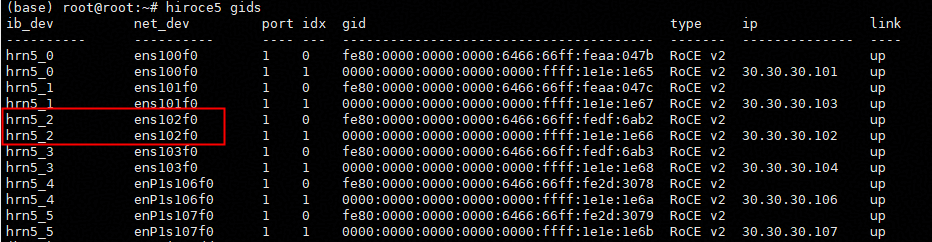
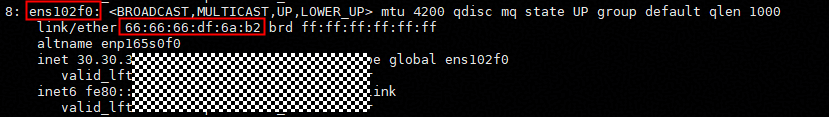
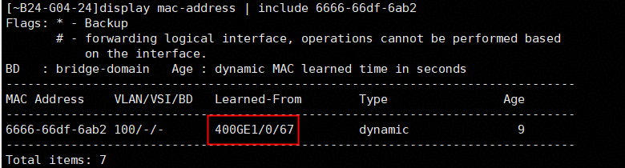

# 常见问题及解决办法

本文按“传输协议 → 发生阶段”组织问题。先确认使用的协议，再区分初始化阶段和 Copy 阶段。
初始化阶段包括运行环境检查、BM 创建、内存分配与注册、内存导入和 Join。

- 协议尚未确定，或涉及公共初始化流程：查看[通用问题](#common)。
- 使用 `device_sdma`：查看[Device SDMA（HCCS）](#device-sdma)。
- 使用 `device_rdma`：查看[Device RDMA](#device-rdma)。
- 使用 `device_urma`：查看[Device URMA](#device-urma)。

| 协议 / 范围 | 初始化报错 | Copy 报错 |
| --- | --- | --- |
| 通用问题 | [驱动和超时](#common-init) | [Copy 报错](#common-copy) |
| Device SDMA（HCCS） | [协议支持、地址预留、内存分配、扫描和导入](#sdma-init) | [地址翻译、搬移错误和返回 -7](#sdma-copy) |
| Device RDMA | [设备打开、网络配置、内存分配、注册和 Swap](#rdma-init) | [Copy 报错](#rdma-copy) |
| Device URMA | [初始化报错](#urma-init) | [批量通知同步超时](#urma-copy) |

内存初始化问题按实际传输协议归类：`ReserveMemorySpace` 失败属于 Device SDMA，
`AllocLocalMemory` 和静态大页注册失败属于 Device RDMA。A3 的 HCCS 可用内存问题与 SDMA 放在同一组。

新增问题或协议时，请参照文末的[内容维护指南](#maintenance)。

<a id="common"></a>

## 1. 通用问题

<a id="common-init"></a>

### 1.1 初始化报错

<a id="driver-version"></a>

#### 1.1.1 无法读取 HDK 驱动版本

**问题现象**

```text
check driver version failed, read version is empty, baseVer: V100R0001C23SPC005B219
```

![image.png][faq-image-1]

**问题根因**

mf初始化是会校验HDK版本以保证后续流程正确，如果没有安装HDK或者在容器中没有映射HDK安装路径（一般在/usr/local/Ascend/driver/目录）

**解决方法**

检查物理机是否安装HDK，并保证映射HDK安装目录到容器内

<a id="join-timeout"></a>

#### 1.1.2 Join 超时

**问题现象**

MF报错日志

```text
2026-04-29 12:09:02.059776 ERROR [68742-68742][SMEM smem_bm_entry.cpp:348 Join] join timeout. rank:62
2026-04-29 12:09:02.059806 ERROR [68742-68742][MMC mmc_bm_proxy.cpp:67 InitBm] Failed to join smem bm
2026-04-29 12:09:02.059847 INFO [68742-89371][SMEM smem_thread_pool.cpp:139 RunInThread] thread executor3 finished.
2026-04-29 12:09:02.059845 INFO [68742-89367][SMEM smem_thread_pool.cpp:139 RunInThread] thread executor1 finished.
```

**问题根因**

MF对于集群加入事件是串行操作，其他未加入的集群在超时时间内进行反复重试，默认超时时间为60s，集群规模较大时或网络延迟较大的环境上有概率出现Join超时错误。

**解决方法**

通过环境变量 export MF_GROUP_JOIN_MAX_TIMEOUT=600 增大集群加入超时时间，单位秒

<a id="collective-timeout"></a>

#### 1.1.3 内存池初始化导致上层集合通信算子超时

**问题现象**

初始化阶段提示集合通信算子超时

```text
(Worker_DP0_TP1_EP1 pid=50452) INFO 05-26 16:49:36 [compiler_interface.py:162] enable_npugraph_ex is enabled, which will
    bring graph compilation optimization.
(Worker_DP0_TP1_EP1 pid=50452)
    /usr/local/python3.11.14/lib/python3.11/site-packages/torch_npu/dynamo/torchair/configs/compiler_config.py:106:
    UserWarning: The following torchair config or properties may not take effect or report error in reduce-overhead
    mode: config.experimental_config.enable_view_optimize:True, set_dim_gears, dynamo_export, scope, npu_print
(Worker_DP0_TP1_EP1 pid=50452)   warnings.warn(
(EngineCore_DP0 pid=50300) INFO 05-26 16:50:11 [shm_broadcast.py:681] No available shared memory broadcast block found
    in 60 seconds. This typically happens when some processes are hanging or doing some time-consuming work (e.g.
    compilation, weight/kv cache quantization).
[rank4]:[E526 16:50:11.939936730 compiler_depend.ts:454]
    operator():build/CMakeFiles/torch_npu.dir/compiler_depend.ts:162 NPU function error: call
    aclnnMoeDistributeDispatchV4 failed, error code is 561000
[ERROR] 2026-05-26-16:50:11 (PID:50397, Device:0, RankID:0) ERR00100 PTA call acl api failed.
EZ9999: Inner Error!
EZ9999[PID: 50397] 2026-05-26-16:50:11.836.043 AclNN_Inner_Error(EZ9999):  Nnopbase fails to invoke the
    HcclAllocComResourceByTiling function of the hccl module. ret = 4, comm = 0xfffcc9385800.
        TraceBack (most recent call last):
       Check nnopbase::IndvHcclWrapper::GetInstance().HcclAllocComResourceByTiling(commHandle, stream,
    ((NnopbaseTilingData *)executor->args->tilingInfo.tilingData)->GetData(), &contextAddr) failed
       Check NnopbaseGetHcomResource(executor, stream) failed
       Check NnopbaseExecutorGetMc2Num(executor, stream, &argsAddr, &mc2Num) failed
       Check NnopbaseExecutorPrepareParamsExt(executor, stream) failed
       Check NnopbaseRunWithWorkspace(executor, stream, workspace, workspaceSize) failed

Exception raised from operator() at build/CMakeFiles/torch_npu.dir/compiler_depend.ts:162 (most recent call first):
frame #0: c10::Error::Error(c10::SourceLocation, std::__cxx11::basic_string<char, std::char_traits<char>,
    std::allocator<char> >) + 0xb0 (0xfffdeea6c700 in
    /usr/local/python3.11.14/lib/python3.11/site-packages/torch/lib/libc10.so)
```

**问题根因**

MF初始化时存在一些较为耗时的操作，比如申请并映射大量内存，加入集群且加入事件为串行操作，导致有些前面启动的节点初始化完成之后继续执行上层业务的通信算子，而此时其他节点仍在处在初始化MF阶段，导致集合通信超时。

**解决方法**

通过环境变量 export HCCL_EXEC_TIMEOUT=3600 增大集群加入超时时间
参考文档：https://www.hiascend.com/document/detail/zh/canncommercial/900/API/hcclug/hcclenvref_07_0003.html

<a id="config-store-port-range"></a>

#### 1.1.4 配置存储 HA 端口范围过窄导致主备倒换失败（读写返回 -3004）

**问题现象**

etcd 模式双 meta 部署下，对其中一个 meta 做 stop 故障注入后，业务读失败并报 -3004（超时），且长时间不自动恢复，客户端日志：

```text
WARN  [MMC mmc_net_engine_acc.cpp:350 Call] Peer 0 doesn't response within 60 seconds
ERROR [MMC mmc_net_engine.h:273 Call] NetEngine call error, op 12, peerId 0, error code -3004
ERROR [MMC mmc_client_default.cpp:561 BatchGet] client mmc_client batch get failed, error code -3004
```

存活 meta 的日志中反复出现：

```text
ERROR [SMEM network_endpoint_util.cpp:292 FindAvailablePort] no available port found,
      isIpv6=0, startPort=15950, endPort=15951, excludePort=15951
```

客户端与 local service 侧持续报配置存储中没有 leader：

```text
WARN [SMEM smem_ha_config_store.cpp:794 HealthCheckThreadFunc] Backend check failed 1, ret: -404, model: 0, isLeader: 0, leaderLinkAlive: 0
INFO [SMEM smem_ha_config_store.cpp:586 ConnectToLeaderAsFollower] No leader registered yet, attempt 19/60
```

**问题根因**

`MF_CONFIG_STORE_PORT_START` 和 `MF_CONFIG_STORE_PORT_END` 被配置成了只覆盖两个端口的区间（示例中为 15950~15951），而 leader 上任需要从该区间同时获取两个空闲端口：`TryBecomeLeader` 中先后两次调用 `FindAvailablePort`，第一次选配置存储服务端口，第二次排除已选端口后再选 bindable 地址端口。区间内可用的空闲端口不足两个时，`FindAvailablePort` 直接返回失败，`TryBecomeLeader` 中止，备节点会持续重试但始终无法当选，etcd 中一直没有 leader 记录。

如果故障注入使用的是 stop（SIGSTOP 冻结）而非 kill，被冻结的旧 leader 进程仍然持有原端口（TCP 连接不断开、端口不释放），备节点就再也拿不到这两个端口；同时客户端已有链路不会断开（不触发断链重连），也没有新 leader 地址可切换（`leader/bindable_addr` 一直 -404），请求只能等到本地超时返回 -3004。

**解决方法**

1. 将配置存储 HA 端口区间放宽，保证同时存在 2 个以上空闲端口，例如：

   ```shell
   export MF_CONFIG_STORE_PORT_START=15950
   export MF_CONFIG_STORE_PORT_END=15999
   ```

   也可以不设置这两个环境变量，使用默认区间（9000~65535）。

2. 确认已解决：leader 上任日志中不再出现 `no available port found`，且随后有 `Registered in backend: <ip>:<port>`；备节点上任后，客户端日志中 `discover leader url empty`、`ret: -404` 消失，读写恢复正常。

3. 使用 SIGSTOP 类 stop 注入时，被冻结的进程不会释放端口，属于最难恢复的场景，建议对 stop 与 kill 两种注入方式分别验证主备倒换。

<a id="common-copy"></a>

### 1.2 Copy 报错

暂无条目。跨协议共用或尚未明确协议归属的 Copy 问题可追加在本节。

<a id="device-sdma"></a>

## 2. Device SDMA（HCCS）

<a id="sdma-init"></a>

### 2.1 初始化报错

本节包括协议支持检查、地址预留、内存配置、内存分配和导入问题。

<a id="sdma-unsupported"></a>

#### 2.1.1 DRAM segment 不支持 SDMA

**问题现象**

```text
dram segment does not support sdma in current environment
```

**问题根因**

1. A3 环境HDK版本低于25.5.0
2. A2 环境误用了device_sdma

<a id="reserve-memory"></a>

#### 2.1.2 ReserveMemorySpace 失败（ret: 3）

**问题现象**

```text
[HYBM hybm_vmm_based_segment.cpp:66 ReserveMemorySpace]
prepare virtual memory size(134217728) failed. ret: 3
```

**问题根因**

A2/A3环境上vmm接口reserve的size需要1G对齐

**解决方法**

修改初始化maxDramSize配置

<a id="halmemcreate"></a>

#### 2.1.3 HalMemCreate 失败（ret: 6）

**问题现象**

vmm_segment中调用HalMemCreate，日志中有如下打印：

```text
Try HalMemCreate ret: 6
```

**问题根因**

1. 内存不足（5.10内核情况下）

   如果指定了numa就是当前numa上DRAM不足，如果未指定numa则是当前环境内存不足。
   因为hccs总线上的DRAM地址范围是固定的，部分环境上并不是所有DRAM都在hccs总线上，
   只有和hccs地址有交集的部分可以被申请

2. 使用了6.6版本内核

   6.6的新版本内核的alloc_contig_range函数不支持传入__KA_GFP_NORETRY和__KA_GFP_ACCOUNT，HDK暂未适配该内核版本
   该修改见 [Linux 内核提交][kernel-page-alloc]。
   openEuler在6.6.0-114.0.0合入该修改，可以下载当前os的kernel-source包，并查看mm/page_alloc.c文件是否有该pr的修改

**解决方法**

可以通过lsmem命令查询本机的物理地址范围，和如下4个区间取交集得到具体可用容量

0x29580000000-0x34000000000

0xa9580000000-0xb4000000000

0x129580000000-0x134000000000

0x1a9580000000-0x1b4000000000

另外，因为存在其它进程争抢内存，所以实际可申请量会更低，没有什么解决手段，建议重启或者减少内存配置

**查看系统可用内存**

运行`mfcli`工具扫描可用的物理内存：

`mfcli mem scan`

![image.png][faq-image-2]

memfabric使用2MB和1GB的大页，脚本默认按照1GB规格扫描，如果要扫描2MB规格大页的可用内存，可以按如下指令运行：

`mfcli mem scan -m 2`

<a id="mem-scan"></a>

#### 2.1.4 A3 可用内存扫描结果与预期不符

memfabric内部两种规格页来初始化内存池，优先使用1GB大页申请，如果申请失败则转为使用2MB页申请，可以通过`mfcli`工具来扫描机器上可用的2MB页、1GB页大小

**问题根因**

A3可用内存地址范围有限制，不同内存规格机器可用内存大小不同，但一般来说常见的A3机器有3TB、2TB两种

3TB机器可用2.3TB内存（推荐池化1TB~1.5TB内存）

2TB内存机器可用680GB内存（推荐池化600GB内存）

但是很多时候实际却申请不到那么多（报错见 [HalMemCreate 失败](#halmemcreate)），常见原因：

1.机器运行时间久了，内存碎片化导致无法分配可用的连续1GB页

2.机器上的其他进程或者缓存占用了内存池可用的地址范围，导致可用内存不足

**解决方法**

1.如果扫描2MB页可用内存比1GB页多，那么就是内存碎片比较严重，这个时候又由于ZonePageSize的机制，导致可用内存急剧减少，没有比较好的方法，推荐重启机器

2.推荐杀掉占用进程，并使用 `echo 3 > /proc/sys/vm/drop_caches` 卸载缓存，然后采用[分离部署方案][memcache-separated]的方式，优先拉起内存池进程

3.参考[A3 HCCS场景扩大可用内存空间指导][memcache-bios]升级BIOS彻底解决

<a id="halmemimport"></a>

#### 2.1.5 A3 HalMemImport 失败（ret: 17）

![image.png][faq-image-3]

HalMemImport memory failed: 17 为内核请求错误，根本原因可能有多种，需要根据plog详细分析，最常见的原因有如下：

**问题根因**

1.驱动HDK版本太老，A3 走 device_sdma协议需要满足 HDK版本 >= 25.5.1，如果需要多机部署还需要升级1520交换机（升级方法见主页）

2.系统内核版本(`uname -a` 查看) >= 5.10

**解决方法**

1.升级HDK到推荐版本

2.升级操作系统内核版本

<a id="sdma-copy"></a>

### 2.2 Copy 报错

<a id="sdma-page-error"></a>

#### 2.2.1 transfer page error, smmu return terminate

**问题现象**

调用HalCqReportRecv时，日志中有如下打印：

```text
transfer page error, smmu return terminate
```

**问题根因**

smmu地址翻译错误，也就是device侧的页表中没有这个va

**解决方法**

可以先检查一下是否误将host的va传入了，比如创建了一个cpu的tensor并将该地址传入

通过解析sqe可以确定是哪两个地址，或者msnpureport抓取device侧tsdrv的日志能得到具体访问哪个地址报错的

可能原因是远端地址未完成本地import就直接访问，或者该地址内存已释放

![image.png][faq-image-4]
00020000是传输的size

178a0000 000012de 组成src地址 0x000012de178a0000

00000000 0000280a 组成dest地址 0x0000280a00000000

还有一种可能，就是hdk版本低于商发的25.5.0版本，在INFO日志级别下会有如下打印
![image.png][faq-image-5]

<a id="sdma-comperr"></a>

#### 2.2.2 sdma move COMPERR ERROR / COMPDATAERR ERROR

**问题根因**

sdma引擎在做数据搬移时发生错误，一般情况下是1520的问题

**解决方法**

优先检查是否升级了1520到推荐版本，
然后可以登录1520，输入命令

```bash
display startup
```

然后查看system software打印的LCN版本是不是1.5.0以上版本，如果低于1.5.0版本需要升级1520
如果版本已经满足，可以输入命令

```bash
display hccs decode and map table interface 200GHL 1/1/2
```

然后查看是否有0x800000000000以上地址段的配置项，没有的话可能1520配置有问题

可以输入以下命令查询当前配置

```bash
display superpod information
```

![image.png][faq-image-6]

期望为Configuration mode为Typical，如果不是可以使用下面指令切换

```bash
sys
superpod configuration typical atlas800t_192_topo1
commit
q
reboot
```

进一步，可以执行如下命令观测1520上是否存在超时代答等异常，有异常需要联系1520的同事定位

```bash
display hccs proxy response statistics    # 查询是否存在超时代答,有非0项即存在异常
display hccs route miss statistics    # 查询路由miss次数，有非0项即存在异常
display alarm active    # 查询环境当前警告，一般情况下不会存在警告
```

<a id="sdma-copy-minus7"></a>

#### 2.2.3 SDMA Copy 返回 -7

**问题现象**
日志中有如下报错

```text
[HYBM hybm_data_op_sdma.cpp:580 InnerWait] BatchCopyG2G wait copy stream:0 waitId:0 failed:-7
[HYBM hybm_entity_default.cpp:828 BatchCopyData] Data copy failed, ret: -7
```

**问题根因**
优先搜索plog日志查看是否有ERROR打印
如无异常，请在宿主机上执行 msnpureport -f 收集全量日志
然后find一下device_fw.log查找一下异常npu对应的该日志文件
搜索该日志文件的ERROR日志，如果有 sdma move COMPERR ERROR 或 sdma move COMPDATAERR ERROR 的打印，是和 SDMA 搬移错误相同的问题，参考[SDMA
搬移错误](#sdma-comperr)的分析方法

<a id="device-rdma"></a>

## 3. Device RDMA

<a id="rdma-init"></a>

### 3.1 初始化报错

<a id="tsdopen"></a>

#### 3.1.1 BM 创建失败：TsdOpen 失败（ret: 31）

**问题现象**

创建BM时，打开device失败，日志中报以下错误：

```text
[HYBM device_rdma_transport_manager.cpp:506 OpenTsd] TsdOpen for (deviceId=1, rankCount=2) failed: 31
[HYBM device_rdma_transport_manager.cpp:474 PrepareOpenDevice] open tsd failed.
[HYBM device_rdma_transport_manager.cpp:79 OpenDevice] PrepareOpenDevice failed.
[HYBM hybm_entity_default.cpp:1076 InitTransManager] Failed to open device, ret: -1
[HYBM hybm_entity_default.cpp:61 Initialize] init transport manager failed
[HYBM hybm_big_mem_entry.cpp:35 hybm_create_entity] initialize entity failed: -1
[SMEM smem_bm_entry.cpp:54 Initialize] create entity failed
[SMEM smem_bm.cpp:176 smem_bm_create] entry init failed, result: -1
```

**问题根因**

此问题是因为环境上Id为1的NPU卡被占用，可以用npu-smi info进行查看

**解决方法**

换一张空闲的卡或者等此卡空闲了再使用

<a id="hccl-init"></a>

#### 3.1.2 HcclCommInitClusterInfoMemConfig 失败（ret: 19）

报错日志

```text
2026-06-23 15:29:50.683548 ERROR [2229-2229][HYBM device_rdma_transport_manager.cpp:520 GetRdmaHandleAfterInitHccI]
    HccICommInitClusterInfoMemConfig failed! ret:19
2026-06-23 15:29:50.683585 ERROR [2229-2229][HYBM device_rdma_transport_manager.cpp:563 PrepareOpenDeviceV2]
    PrepareOpenDeviceV2 failed.
2026-06-23 15:29:50.683595 ERROR [2229-2229][HYBM device_rdma_transport_manager.cpp:83 OpenDevice] PrepareOpenDevice
    failed.
2026-06-23 15:29:50.683608 ERROR [2229-2229][HYBM compose_transport_manager.cpp:68 OpenDevice] Failed to open device
    transport nic: tcp://127.0.0.1:7600
2026-06-23 15:29:50.683619 ERROR [2229-2229][HYBM hybm_entity_default.cpp:1174 InitTransManager] Failed to open device,
    ret: -1
2026-06-23 15:29:50.683648 ERROR [2229-2229][HYBM hybm_entity_default.cpp:115 Initialize] Failed to init trans manager.
2026-06-23 15:29:50.683681 ERROR [2229-2229][HYBM hybm_big_mem_entry.cpp:35 hybm_create_entity] Initialize entity
    failed: -1
2026-06-23 15:29:50.684789 ERROR [2229-2229][SMEH smem_bm_entry.cpp:44 Initialize] create entity failed
2026-06-23 15:29:50.684795 ERROR [2229-2229][SMEH smem_bm.cpp:257 smem_bm_created] entry init failed, result: -1
2026-06-23 15:29:50.684798 ERROR [2229-2229][MMC mmc_bm_proxy.cpp:60 InitBm] Internal create bm failed
2026-06-23 15:29:50.696385 ERROR [1973-1973][HYBM device_rdma_transport_manager.cpp:520 GetRdmaHandleAfterInitHccI]
    HccICommInitClusterInfoMemConfig failed! ret:19
2026-06-23 15:29:50.696395 ERROR [1973-1973][HYBM device_rdma_transport_manager.cpp:563 PrepareOpenDeviceV2]
    PrepareOpenDeviceV2 failed.
2026-06-23 15:29:50.696395
```

**问题根因**

环境没有配置device_rdma网卡，可以使用 hccn_tool命令验证，如果网口显示为DOWN，则证明没有配置device_rdma网络

```bash
for i in $(seq 0 7); do echo "==> $i"; hccn_tool -i $i -link -g; done
```

**解决方法**

联系机器运维人员配置device_rdma网卡，或使用其他传输协议，A3推荐使用device_sdma

<a id="alloc-local-memory"></a>

#### 3.1.3 AllocLocalMemory 报 Cannot allocate memory（error: 12）

**问题现象**

初始化时，日志中有如下打印：

```
Cannot allocate memory
```

**问题根因**

conn_based_segment需要配置静态大页

**解决方法**

可以通过以下命令查询当前配置数量

```
cat /proc/meminfo | grep HugePages_Total
```

然后通过以下命令，临时配置所需的静态大页

```
echo 65536 > /proc/sys/vm/nr_hugepages
```

如果是期望跑SDMA的场景走到了conn_base_segment，可能是HDK版本太老,建议更新HDK

<a id="hugepage-register"></a>

#### 3.1.4 静态大页注册失败（register host va failed, ret: 4）

plog

```
[ERROR] DRV(10457,):2026-06-18-07:01:55.619.835
    [drv_share_log.c:238][ascend][curpid:10457,10457][drv][devmm][share_log_read_in_single_module]Get_user_pages_fast
    fail. (va=0x280040000000; expected_page_num=512; real_got_page_num=0) Get pages fail. (va=0x280040000000;
    expected_num=2621440; ret=-14) Get pages fail. (va=0x280040000000; expected_num=2621440; ret=-14) Map shm fail.
    (src_va=0x280040000000; size=10737418240; devid=0; map_type=3; ret=-14)
[ERROR] DRV(10457,):2026-06-18-07:01:55.619.854
    [devmm_svm.c:2769][ascend][curpid:10457,10457][drv][devmm][_devmm_mem_remote_map]<errno:14, 4> Mem_remote_map ioctl
    error. (src_va=0x280040000000; size=10737418240; devid=0; ret=4)
```

**问题根因**

os版本的问题，使用了静态大页，但是没有立即映射到页表上，需要pagefault触发

**解决方法**

改用halMemAlloc方式申请内存：

- 大页数量配置为0
- 启用56bits GVA（ock.mmc.local.max.dram.size = 1024GB，world_size=256）

<a id="rdma-4k-register"></a>

#### 3.1.5 4K 页内存注册失败（错误码 0x1f466）

**问题现象**

MF报错日志

```text
2026-04-28 20:55:56.591186 ERROR [150276-150667][HYBM device_rdma_transport_manager.cpp:148 RegisterMemoryRegion]
    register MR=MemoryRegion(size=0x980000000, addr=0x280040000000, access=0x7, flags=0x1), device_va=0x6f677c00000
    failed: 1f466
2026-04-28 20:55:56.591312 ERROR [150276-150667][HYBM compose_transport_manager.cpp:117 RegisterMemoryRegion] Failed to
    register memory region MemoryRegion(size=0x980000000, addr=0x280040000000, access=0x7, flags=0x1)
2026-04-28 20:55:56.591345 ERROR [150276-150667][HYBM hybm_entity_default.cpp:216 AllocLocalMemory] register memory
    region allocate failed: -6, info: MemoryRegion(size=0x980000000, addr=0x280040000000, access=0x7, flags=0x1)
```

plog

```text
[ERROR] HCCP(150276,python3):2026-04-28-20:55:56.591.120 [ra_hdc_rdma.c:618]tid:150667,RaHdcTypicalMrReg :
    [reg][ra_hdc_typical_mr]ra hdc message process failed ret(-13) phy_id(6)
```

**问题根因**

错误码0x1f466转换为十进制为128102，根据HCCP错误码编码方式

```text
#define CONVER_ERROR_CODE(module, err_type, module_errcode) ((err_type) * 100000 + (HCCP_MODULE_ID) * 1000 + (module) *
    100 + (module_errcode))  /* Combine a 6-digit ACL error code. */
```

可以解析得到详细报错为
err_type=1
module=1
module_errcode=2
查阅枚举表可得原始报错为EACCES（permission denied）

原因是用4K页申请较大的内存空间时，表项占用的内存超过了限制，所以如果不能配置大页，那么需要降低申请的内存空间大小

**解决方法**

降低内存容量到30G以内

<a id="rdma-swap"></a>

#### 3.1.6 RDMA Swap 内存分配失败（ret: -8）

**问题现象**

```text
Failed to HalMemAlloc rdma swap memory, size xx, ret: -8
```

![image.png][faq-image-7]

原因是HalMemAlloc不到足够的内存，这块Swap区间不是必须的，可以通过下面的命令关掉
export HYBM_RDMA_SWAP_SPACE_SIZE=0

<a id="rdma-copy"></a>

### 3.2 Copy 报错

#### 3.2.1 RaSendWrV2 failed, ret: 328100

**问题现象**

MF报错：

```text
RaSendWrV2 failed, ret: 328100
```

**问题跟因**

短时间内下发的 WR 数量超过已完成的数量 32767 个。
`328100` 是 HCCP 内部`-ENOMEM` 经过`ConverReturnCode()` 转换后的错误码，含义是 RoCE/lite 发送队列已满（SQ backpressure，发送队列无法继续接收新的 WR）。
HCCP 后台`hccp_hdc_lite` 线程 每 10ms 才轮询一次 CQE 回收，在轮询间隙内，如果 WR 下发速度高于 CQE 回收速度，就会触发背压。

**解决方案**

1. 调整队列深度到最大

   ```shell
   export MF_NPU_RDMA_SEND_CQ_DEPTH=32768
   export MF_NPU_RDMA_RECV_CQ_DEPTH=32768
   export MF_NPU_RDMA_MAX_SEND_WR=32767
   export MF_NPU_RDMA_MAX_RECV_WR=32767
   ```

2. 1.3.0 及以上版本，可以使用基于AICPU的device_rdma方案

   ```shell
   mfcli kernel install
   export MF_HYBM_RDMA_USE_AICPU=1
   ```

<a id="rdma-copy-port-bridge"></a>

#### 3.2.2 1825 网卡单机多 NPU 共用同一物理端口，RDMA 通信失败（ret: 19）

**问题现象**

   ```text
   HcommChannelFenceOnThread failed, rank: N ret: 19
   ```

对应 plog：

   ```text
   ibv_poll_cq error. wc[0] status[12]        // IBV_WC_RETRY_EXC_ERR
   WaitForSingleQpWqeCompletion: hcclRet -> 19
   BuiltinFenceOnThread FAIL
   ```

**问题根因**

1825 网卡在单机多 NPU 场景下，若多个 NPU 共用同一物理端口，两个 NPU 间的 RDMA 流量会从该端口发出、经交换机后从同一端口返回。交换机默认丢弃此类**同源同宿报文**，导致重传次数耗尽，最后通信失败。

**解决方案**

交换机对应接口开启**端口桥**（port bridge）功能。

> 详细说明：[配置端口桥功能](https://support.huawei.com/hedex/hdx.do?docid=EDOC1100558302&id=ZH-CN_TASK_0000001176744393)

1. 确认 NPU 所连交换机端口，首先需要了解物理连线，明确网卡各端口与 NPU 卡的对应关系（即哪些 NPU 共用同一网卡端口）。

   **常用排布参考（8卡机型）：**

   | NPU 卡 | 网卡设备 |
   |--------|----------|
   | 0、1   | hrn5_1   |
   | 2、3   | hrn5_0   |
   | 4、5   | hrn5_3   |
   | 6、7   | hrn5_2   |

   例如，若需要 NPU 6 和 NPU 7 之间通信，二者共用 `hrn5_2` 端口，需在交换机对应的 `hrn5_2` 端口上开启端口桥。

   - 通过 `ibv_devinfo` 或 `hiroce5 gids` 查看网络设备（`net_dev` 列）：

     ```bash
     ibv_devinfo
     # 或
     hiroce5 gids
     ```

   

   - 通过 `ifconfig <net_dev>` 或 `ip link show <net_dev>` 查看对应接口的 MAC 地址：

     ```bash
     ifconfig <net_dev>
     # 或
     ip link show <net_dev>
     ```

   

   - 根据该 MAC 地址，在交换机上查询对应端口号：

     ```bash
     display mac-address | include <mac-address>
     ```

   

   > 注：上述命令中的 `<net_dev>` 需替换为上一步查询到的实际网络设备名（如 `enp3s0`），`<mac-address>` 需替换为上一步查询到的实际 MAC 地址（格式如 `aabb-ccdd-eeff`）。
   >
   > 注：若需查询 NPU 6、7（共用 `hrn5_2`，需端口桥）或 NPU 5、6（跨 `hrn5_3` 与 `hrn5_2`，无需端口桥）对应的交换机端口，需先在这两组 NPU 之间各进行一次 RDMA 通信（例如运行 `rdma_demo`），使交换机学到对应的 MAC 表项，否则 `display mac-address` 可能查不到对应记录。

2. 登录交换机，进入系统视图：`system-view`
3. 进入对应接口（以 100GE1/0/1 为例，按实际替换）：

   ```bash
   interface 100GE1/0/1
   ```

4. 开启端口桥：

   ```bash
   port bridge enable
   ```

5. 提交：`commit`
6. 验证：`display current-configuration | include port bridge`，输出含 `port bridge enable` 即成功。
7. 多个接口需同端口通信时，对每个接口重复 3-5。

配置完成后，在使用相同网卡端口的 NPU 卡上运行 `rdma_demo` 即可验证通信是否正常。

<a id="device-urma"></a>

## 4. Device URMA

<a id="urma-init"></a>

### 4.1 初始化报错

暂无条目。

<a id="urma-copy"></a>

### 4.2 Copy 报错

<a id="urma-batch-notify-timeout"></a>

#### 4.2.1 device_urma batch notify synchronize failed（syncRet: 107020）

**问题现象**

```text
device_urma batch notify synchronize failed, rankNum: 1 waitRet: 0 syncRet: 107020
```

**问题说明**

该报错表示 Device URMA 在等待批量传输完成通知时，stream 同步返回 `107020`（任务超时）。
这条日志不能单独确定根因。

**排查方法**

1. 先在故障环境执行不同方向（如d2rh） benchmark：

   ```bash
   mfcli benchmark --device 0,1,2,3,4,5,6,7 --protocol device_urma \
     --direction d2rh --block-size 2M
   ```

2. 若 benchmark 也出现异常，尝试2.3.RC1.SPC1版本之后的LingQu Computing Link 的 CC 包，并按实际组网检查 CFG，保留 benchmark 输出及故障时间附近的日志。
3. 若 benchmark 通过，再结合原业务场景排查。

<a id="maintenance"></a>

## 内容维护指南

### 新问题放在哪里

按“实际传输协议 → 发生阶段 → 具体问题”归类，每个协议统一保留“初始化报错”和“Copy 报错”两节。
暂无问题的分类保留“暂无条目”占位；添加首个问题时删除该占位说明。

| 判断项 | 归类规则 |
| --- | --- |
| 协议明确 | 放入实际使用的传输协议章节，例如 `device_sdma` 或 `device_rdma` |
| 多个协议共用，或协议尚不明确 | 放入通用问题对应的阶段，说明已验证范围或待确认信息 |
| 初始化报错 | 环境检查、BM 创建、内存分配 / 注册 / 导入、建链或 Join 阶段失败 |
| Copy 报错 | 数据拷贝发起、等待完成或结果检查阶段失败 |

- 以实际失败的调用阶段归类；上层显示 Copy 失败、根因在此前初始化时，链接到已有初始化问题。
- 配置存储地址中的 `tcp://`、`etcd://` 等表示配置存储方式，不能据此认定数据传输协议。
- 同一问题只维护一份正文。其他协议或阶段需要引用时，添加链接并说明适用关系。
- 新协议单独建立章节，保持 Device / Host 等名称区分；没有问题的阶段保留占位。

### 追加已有协议的问题

1. 在对应协议、对应阶段的末尾追加条目，使用该节的下一个编号，尽量不改已有编号。
2. 标题包含可搜索的错误接口、错误码或关键日志；正文按下面模板填写。
3. 将模板锚点改成唯一、稳定的英文名称，例如 `device-rdma-copy-cq-error`。
   后续修改标题或编号时保留该锚点，文内引用使用锚点链接。
4. 补充已验证的硬件和软件版本。固定容量、超时、驱动版本等结论应说明适用条件。
5. 保留日志中的接口名、错误码和关键参数；日志文字优先于截图，命令单独放入代码块。

下面模板中的 `A.B.C` 替换为实际编号，尖括号中的说明替换为问题内容；可选字段无内容时删除。
根因尚未确认时写明已知现象和排查进展，避免把推测写成确定结论。

````markdown
<a id="protocol-stage-error-keyword"></a>

#### A.B.C 错误接口或关键日志（错误码）

**适用范围**

- 传输协议：<实际配置值>
- 发生阶段：<初始化 / Copy>
- 环境与版本：<已验证的硬件、MemFabric、HDK / CANN、OS 版本；未确认项注明>

**问题现象**

<触发操作与失败表现>

```text
<保留关键接口、错误码及定位参数的日志>
```

**问题根因**

<已确认的原因及判断依据，或当前排查进展>

**解决方法**

1. <检查或处理步骤，并说明执行条件>
2. <如何确认问题已解决>

**相关问题（可选）**

[相关问题标题](#existing-problem-anchor)
````

### 新增传输协议

在“内容维护指南”之前追加协议章节，一级编号接在现有协议之后。
将下面的 `N` 替换为实际编号，`protocol-name` 替换为唯一协议标识，并替换协议名称及配置值。
再更新文首导航和总览表，分别链接到新协议的初始化、Copy 两个锚点。

````markdown
<a id="protocol-name"></a>

## N. 协议名称（配置值：`protocol_name`）

<a id="protocol-name-init"></a>

### N.1 初始化报错

暂无条目。

<a id="protocol-name-copy"></a>

### N.2 Copy 报错

暂无条目。
````

### 发布前检查

- 分类和触发阶段准确，正文与已有问题没有重复。
- 新条目的标题、日志、原因和处理步骤足够支持独立排查。
- 内部锚点唯一，导航与相关问题链接指向正确位置。
- 命令、环境变量和版本条件经过核对，截图与文字对应。

[faq-image-1]: https://raw.gitcode.com/user-images/assets/7672916/c824a751-61a2-4b77-abbf-49620a8e3adf/image.png
[faq-image-2]: https://raw.gitcode.com/user-images/assets/7672916/348c0854-4efb-4803-8222-f6bf19589fa1/image.png
[faq-image-3]: https://raw.gitcode.com/user-images/assets/7672916/87b5923b-f971-428e-a7ed-7ced49b745d7/image.png
[faq-image-4]: https://raw.gitcode.com/user-images/assets/7672916/2c0db8ad-ab35-4caf-973e-6aeb44cea051/image.png
[faq-image-5]: https://raw.gitcode.com/user-images/assets/7672916/2547a47f-bade-4078-9cf7-2bc5a03c9e0a/image.png
[faq-image-6]: https://raw.gitcode.com/user-images/assets/7672916/19aaa7e5-26e9-4240-bd4f-2c2389c494a8/image.png
[faq-image-7]: https://raw.gitcode.com/user-images/assets/7672916/989ad8a1-62b4-4362-b4d9-a59a7cb0b406/image.png

[kernel-page-alloc]:
https://git.kernel.org/pub/scm/linux/kernel/git/torvalds/linux.git/commit/?id=f6037a4a686523dee1967ef7620349822e019ff8
[memcache-separated]: https://gitcode.com/Ascend/memcache/wiki/MemCache+vLLM+A3分离部署案例.md
[memcache-bios]: https://gitcode.com/Ascend/memcache/wiki/MemCache扩大A3可用内存空间.md
